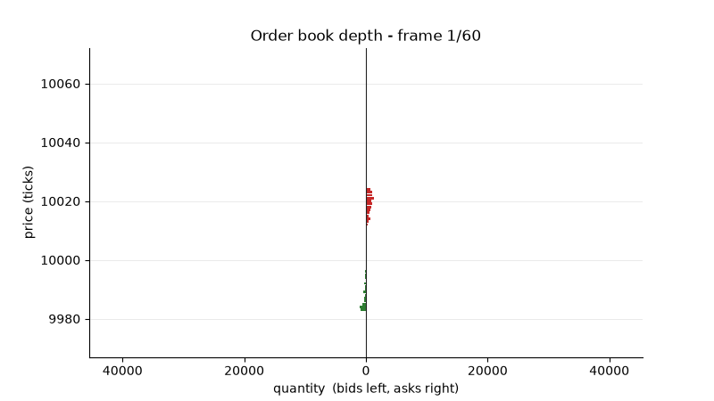

# orderbook

[](https://github.com/IkerAbad/orderbook/actions/workflows/ci.yml)
[](LICENSE)


Limit order book and matching engine in C++23. Price-time priority, integer
prices, three implementations of the same contract, no external dependencies,
and a benchmark you can reproduce on your own machine.



## Three implementations, one contract

All three expose the same methods: `add_limit`, `add_market`, `cancel`,
`modify`, `best_bid`, `best_ask`, `quantity_at`, `depth`, `order_count` and
`level_count`.

| | `Book` | `ArrayBook` | `PoolBook` |
|---|---|---|---|
| Price levels | `std::map` | contiguous array by tick | contiguous array by tick |
| Resting orders | `std::list` nodes | `std::list` nodes | preallocated vector, integer links |
| Order lookup | `std::unordered_map` | `std::unordered_map` | open-addressing table |
| Heap use per resting order | list node + map node | list node + map node | none |
| Price range | unbounded | fixed ladder | fixed ladder |
| Resting capacity | unbounded | unbounded | fixed at construction |

`PoolBook` keeps orders in a `std::vector<Order>` and recycles slots through a
free list of integer indices. Each price level stores `head` and `tail` indices,
and the orders at a level form a doubly linked list through two parallel
`std::vector<std::uint32_t>` arrays. Cancel and matching only move indices.

The id lookup is preallocated too: an open-addressing table with linear probing,
sized when the book is created. Removing an order reinserts the rest of its
probe cluster, so lookups keep working without tombstones.

### Complexity

`L` is the number of price levels, `R` the ladder size and `k` the requested
depth. The fills term is the number of makers touched by a match. Cancel is
average O(1) in all three because ids go through a hash table. The difference is
what happens when a level empties.

| Operation | `Book` | `ArrayBook` | `PoolBook` |
|---|---|---|---|
| `add_limit` | O(fills + log L) | O(fills) | O(fills) |
| `add_market` | O(fills) | O(fills) | O(fills) |
| `cancel` | average O(1), O(log L) if the level empties | average O(1), O(R) if the best level empties | average O(1), O(R) if the best level empties |
| `modify` | O(1) in place, O(fills + log L) if it moves | O(1) in place, O(fills) if it moves | O(1) in place, O(fills) if it moves |
| `best_bid` / `best_ask` | O(1) | O(1) | O(1) |
| `quantity_at` | O(log L) | O(1) | O(1) |
| `depth(k)` | O(k) | O(R) | O(R) |
| `level_count` | O(1) | O(R) | O(R) |

`PoolBook` does not allocate in `add_limit`, `add_market`, `cancel` or `modify`
after construction. `depth` allocates its result vector.

## Benchmark

```
$ ./build/orderbook bench --events 1000000 --seed 42 --runs 3 --repeat 10 --impl all
workload  1000000 events, seed 42, ladder [9809, 10339]
map    min 136.6  median 142.6  max 163.6 ns/event   457777 trades
array  min 117.3  median 122.5  max 143.1 ns/event   457777 trades
pool   min 41.8  median 52.3  max 57.7 ns/event   457777 trades
pool memory  36.8 MiB, 650012 slots
```

Measured on a Ryzen 9 5900X, Windows 11, GCC 14.2 in `Release` mode (`-O3`),
single thread. Each repeat is the best of three runs and the table summarises
ten repeats. Using the medians, `PoolBook` is 2.7 times faster than `Book` and
2.3 times faster than `ArrayBook`. The min and max columns show the spread of
this machine. The pool line is followed by the memory reserved for its vectors:
36.8 MiB for 650,012 slots and the id table. The trace itself is not included.
When more than one implementation runs, the command also checks that they
produced the same trade count and volume before printing. A mismatch fails the
run.

The workload comes from the same binary:

```
$ ./build/orderbook generate --events 1000000 --seed 42 --out trace.csv
wrote 1000000 events to trace.csv (650012 limit, 199987 cancel, 150001 market)
```

The generator draws 65 % limit orders, 20 % cancels and 15 % market orders. It
assigns an id to every limit and market order, so the cancel ids stay aligned
with the book. It does not know which orders the book has filled, so some cancel
events reference orders that already executed and the book rejects them. The
rare event where the generator has no id left becomes a market order, which
explains the small drift from the exact percentages.

### Where the time goes

- `map` to `array` saves 20.1 ns/event, 14.1 % of the map median. Price-level
  lookup stops walking a red-black tree and stops allocating a node for every
  new price.
- `array` to `pool` saves 70.2 ns/event, 57.3 % of the array median. A resting
  limit order stops allocating a `std::list` node and an `unordered_map` node,
  and matching stops chasing two pointers per order.
- The second change is about 3.5 times larger than the first. That is the
  measured answer to why the array alone did not stand out: both earlier books
  paid the per-order allocation, and 65 % of the events are limit orders.
- The remaining 52 ns/event are the match loop, the callback, the trade
  counters, the id hash and ordinary branch and cache misses. This build does
  not profile them further.

## What it does

- Limit orders with price-time priority. The first order at a price is the first
  one filled.
- Market orders that walk the book until the quantity is exhausted or the book
  is empty.
- `cancel` in O(1) through a direct index, with no allocation in `PoolBook`.
- `modify` that follows the exchange rule: a price change or a size increase
  loses time priority, a size decrease keeps it.
- Trades always execute at the resting order's price. The maker decides.
- Deterministic: the same seed produces the same trace and the same book.
- A depth export that feeds the plot above.

## Build

Requires CMake 3.25+ and a compiler with C++23 support (GCC 14, Clang 18,
MSVC 19.38).

```
cmake -S . -B build -DCMAKE_BUILD_TYPE=Release
cmake --build build
ctest --test-dir build --output-on-failure
```

The benchmark numbers above were produced with Ninja and GCC 14.2:

```
cmake -S . -B build -G Ninja -DCMAKE_BUILD_TYPE=Release -DCMAKE_CXX_COMPILER=g++
cmake --build build
```

## Presets

`CMakePresets.json` defines the common configurations:

| Preset | Configuration |
|---|---|
| `release` | Release, warnings as errors |
| `debug` | Debug |
| `clang` | Release with `clang++` |
| `asan` | Debug with AddressSanitizer |
| `ubsan` | Debug with UndefinedBehaviorSanitizer |
| `coverage` | Debug with gcov instrumentation |
| `fuzz` | Clang libFuzzer targets, tests off |

```
cmake --preset release
cmake --build --preset release
ctest --preset release
```

The sanitizer presets need the matching runtime installed. The `fuzz` preset
also needs Clang. Debug builds define `_GLIBCXX_ASSERTIONS`, so libstdc++ checks
container bounds.

The `coverage` preset writes gcov data. With `gcovr` installed:

```
cmake --preset coverage
cmake --build --preset coverage
ctest --preset coverage
gcovr -r . build/coverage --filter "src/" --exclude "src/main.cpp" --fail-under-line 90 --txt
```

CI fails if line coverage of the library sources drops below 90 %.

## Use

```
# print the version or the usage
./build/orderbook --version
./build/orderbook --help

# write a synthetic session to CSV
./build/orderbook generate --events 100000 --seed 7 --out trace.csv

# replay it and print the final state of the book
./build/orderbook replay trace.csv

# compare the three implementations
./build/orderbook bench --events 1000000 --seed 42 --runs 3 --impl all

# ten repeats with min, median and max
./build/orderbook bench --events 1000000 --seed 42 --runs 3 --repeat 10 --impl all

# export depth snapshots for the plot
./build/orderbook depth --events 200000 --seed 7 --frames 60 --out depth.csv
python tools/visualize.py --input depth.csv --png docs/depth.png --gif docs/depth.gif
```

As a library:

```cpp
#include <orderbook/book.hpp>

ob::Book book([](const ob::Trade& t) {
    // t.taker, t.maker, t.price, t.quantity
});

book.add_limit(ob::Side::Buy, 10000, 25);   // rests at 10000
book.add_limit(ob::Side::Sell, 10000, 10);  // fills 10 at 10000
```

`ArrayBook` and `PoolBook` take the price ladder range in the constructor.
`PoolBook` also takes the number of orders that can rest at once:

```cpp
#include <orderbook/array_book.hpp>
#include <orderbook/pool_book.hpp>

ob::ArrayBook array_book(9900, 10100, on_trade);
ob::PoolBook pool_book(9900, 10100, 500000, on_trade);
```

A price outside the ladder throws `std::out_of_range`. If the remainder of an
order would need a slot and the pool is full, `add_limit` throws
`std::overflow_error`. A non-crossing order in that situation leaves the book
unchanged. A crossing order keeps the trades it already executed, because they
were matched before the remainder looked for a slot. `PoolBook::memory_bytes()`
returns the bytes reserved by its vectors.

## Install

```
cmake --install build --prefix /some/prefix
```

The install exports `orderbook::orderbook_core` for `find_package`:

```cmake
find_package(orderbook 0.2 CONFIG REQUIRED)
target_link_libraries(app PRIVATE orderbook::orderbook_core)
```

Set `-DBUILD_TESTING=OFF` to skip the tests when the project is included as a
subdirectory or packaged. The `examples/consumer` project is built against an
installed tree in CI.

## Project layout

```
CHANGELOG.md        release notes
include/orderbook/  public headers
src/                library sources and the CLI
tests/              doctest suites, reference model and header self-checks
fuzz/               libFuzzer targets and seed corpora
examples/consumer/  consumer built with find_package
tools/              depth visualizer
```

## Design decisions

**Prices are integers.** `Price` is `std::int64_t` counted in ticks. Floating
point prices accumulate error, compare badly and make equality checks
unreliable. Every serious engine works in integer ticks.

**The maker sets the price.** A buy order that crosses an ask at 101 executes at
101, not at the buyer's limit. This is how equities and futures work, and it is
the opposite of what a naive implementation does.

**Cancel is O(1).** `Book` and `ArrayBook` keep an `unordered_map<OrderId,
Location>` where `Location` holds the level and a `std::list` iterator.
`PoolBook` maps the id to a pool slot with an open-addressing table and unlinks
the slot from its level through `prev` and `next` indices.

**The pool removes the hot-path allocation.** `PoolBook` reserves every order
slot and every link when it is constructed. Resting, cancelling and matching
never touch the heap. The price is a fixed capacity chosen by the caller, and a
full pool is an error instead of a hidden `malloc`.

**One thread.** Determinism is worth more than parallelism here. A benchmark
with threads measures the scheduler as much as the book.

**Books move, they do not copy.** A copy would duplicate every order and, in
`Book` and `ArrayBook`, leave the id index pointing at the original list nodes.
Copy and assignment are deleted. Move is defaulted and keeps the nodes alive.

## Limitations

- No self-trade prevention, iceberg orders, hidden liquidity or auction phases.
- No persistence and no network gateway.
- The trade callback runs inside `add_limit`, `add_market` and `modify`. It must
  not throw or call back into the book.
- `Book` and `ArrayBook` allocate when an order rests. A `std::bad_alloc` during
  that step can leave the book partially updated. `PoolBook` has no allocation
  window after construction.
- The synthetic generator is a Poisson-like flow, not real market data. The CSV
  format exists so real captures can be replayed later.
- `ArrayBook` and `PoolBook` need a fixed price range. Outside it, the price is
  rejected.
- `PoolBook` needs a bound on resting orders. In the benchmark the bound is the
  number of limit events, which is safe but conservative. A production
  deployment would size the pool from its peak live orders plus a margin.
- Per-event latency percentiles are not published because the Windows clock
  ticks at 100 ns, which is the same order as the operation itself. The
  throughput figure does not suffer from that limit.

## Tests

50 cases. The original 19 stay unchanged and cover priority rules, partial
fills, market orders walking several levels, cancel and modify semantics, the
spread invariant under a random workload, trace reproducibility and the array
ladder range. Running `./build/orderbook_tests` reports those 19 cases.

The 31 new cases cover the pool and the edges around it: slot reuse, a middle
cancel that must not break the intrusive list, 1000 full pool cycles, a full
pool, invalid ladders and capacities, spans that overflow `Price`, level totals
that overflow `Quantity`, depth, empty books, zero-depth queries, modify
crossing the spread, modify fully executing, a crossing order that frees pool
slots, the memory footprint, noexcept queries, move-only book semantics, and a
counter that replaces global `operator new` and asserts that 50 rounds of
adding, matching, modifying and cancelling do not allocate. They also check that
every limit and market event consumes one id, so the cancels in a generated
trace reference the order the book actually assigned, and that `parse_csv` works
without a file. The CSV reader round-trips a generated trace and rejects a bad
header, a bad op, a bad side, a non-numeric field, a wrong field count and an
empty file, and it accepts CRLF line endings. Running
`./build/orderbook_pool_tests` reports the 31 new cases.

Both differential tests also compare against an independent reference model that
uses a map of vectors and computes totals on demand. The first runs 20,000
generated events, the second runs 5,000 random operations with modifies. They
compare best prices, live orders, level counts, depth, every trade and the
executed volume. Nine CLI checks cover `--help`, `--version`, a golden replay,
zero runs, zero repeats, a repeat benchmark, zero frames, a missing option value
and an unknown option.

An object library compiles `types.hpp`, `book.hpp`, `array_book.hpp`,
`pool_book.hpp` and `trace.hpp` in separate translation units, so every public
header must stand on its own.

CI runs the tests on Linux and Windows with GCC and MSVC, on Linux with Clang,
and under AddressSanitizer and UndefinedBehaviorSanitizer on Ubuntu. GCC and
Clang also build with `-Wconversion` and `-Wsign-conversion`. GCC adds its
duplicated-condition, logical-op, useless-cast and cast-qual warnings. Warnings
are errors in every compiler job. A separate job checks that line coverage of
the library sources stays at or above 90 %.

## Fuzzing

Two libFuzzer targets are built when `ORDERBOOK_BUILD_FUZZERS=ON` is passed to
Clang:

- `fuzz_parse_csv` feeds arbitrary bytes to `parse_csv`, which must reject
  malformed input with an exception instead of reading out of bounds.
- `fuzz_book` interprets bytes as limit, market, cancel and modify operations
  and aborts if `Book`, `ArrayBook` and `PoolBook` disagree on state or trades.

```
cmake --preset fuzz
cmake --build --preset fuzz
./build/fuzz/fuzz_parse_csv -max_total_time=60 fuzz/corpus_parse
./build/fuzz/fuzz_book -max_total_time=60 fuzz/corpus_book
```

The CI job runs both for 60 seconds with AddressSanitizer and
UndefinedBehaviorSanitizer.

## Español

Libro de órdenes y motor de matching en C++23, con prioridad precio-tiempo,
precios enteros y benchmark reproducible. Sin dependencias externas.

Hay tres implementaciones del mismo contrato: una con niveles en `std::map`,
otra con un array contiguo indexado por tick y una tercera que añade un pool de
órdenes. Las dos primeras reservan memoria por cada orden que descansa en el
libro. `PoolBook` reserva todo al construirse y enlaza las órdenes con índices
enteros, así que cancelar y casar no hacen ninguna reserva.

Sobre un millón de eventos, `PoolBook` es 2,7 veces más rápido que la versión
con `std::map` y 2,3 veces más rápido que la versión con array. El cambio de
`map` a array ahorra 20,1 ns por evento. El cambio de array a pool ahorra 70,2
ns por evento, porque elimina la reserva del nodo de lista y del nodo del índice
por cada orden. Esa era la parte que impedía que el array destacara.

Los tests cubren las reglas de prioridad, las ejecuciones parciales, el recorrido
de niveles por parte de las órdenes a mercado, la semántica de `cancel` y
`modify`, el rango del array, el pool lleno, la reutilización de huecos, la
ausencia de reservas en régimen, el parser CSV y una comparación diferencial
entre las tres implementaciones y un modelo de referencia independiente. El
parser y el motor se someten además a libFuzzer con AddressSanitizer y
UndefinedBehaviorSanitizer.

## License

MIT. See [LICENSE](LICENSE).
