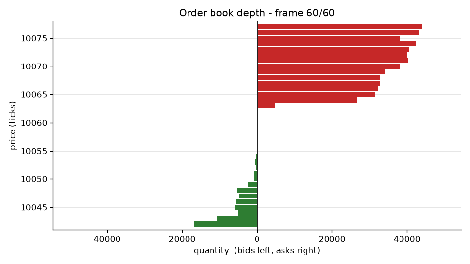

# orderbook

[](https://github.com/IkerAbad/orderbook/actions/workflows/ci.yml)
[](LICENSE)


Limit order book and matching engine in C++23. Price-time priority, integer
prices, no external dependencies, and a benchmark you can reproduce on your own
machine.



## Two implementations, one contract

The same book is built twice: `Book` keeps price levels in a `std::map`, and
`ArrayBook` keeps them in a contiguous array indexed by tick. Both are driven
through the same workload of 1,000,000 events (65 % limit orders, 20 % cancels,
15 % market orders), single thread, best of three runs.

```
$ ./orderbook bench --events 1000000 --seed 42 --runs 3 --impl both
workload  1000000 events, seed 42, ladder [9809, 10339]
map    138.204 ns/event   7235701 events/s   469797 trades
array  121.934 ns/event   8201131 events/s   469797 trades
```

Measured on a Ryzen 9 5900X, GCC 14.2, `-O3`. The array is about 12 % faster.

That number is small on purpose, and the reason is the interesting part: the
cost is dominated by allocating one `std::list` node and one `unordered_map`
entry per resting order, which both implementations share. The array removes the
tree walk to reach a price level, not the per-order allocation. Replacing the
list with an index-based pool is the next step, and it is where the gap should
become large.

Per-event latency percentiles are not published because the Windows clock ticks
at 100 ns, which is the same order as the operation itself. The throughput figure
does not suffer from that limit.

## What it does

- Limit orders with price-time priority. The first order at a price is the first
  one filled.
- Market orders that walk the book until the quantity is exhausted or the book
  is empty.
- `cancel` in O(1) through an id index, with no allocation.
- `modify` that follows the exchange rule: a price change or a size increase
  loses time priority, a size decrease keeps it.
- Trades always execute at the resting order's price. The maker decides.
- Deterministic: the same seed produces the same trace and the same book.
- A depth export that feeds the plot above.

## Build

Requires CMake 3.25+ and a compiler with C++23 support (GCC 14, Clang 18,
MSVC 19.38).

```
cmake -S . -B build -DCMAKE_BUILD_TYPE=Release
cmake --build build
ctest --test-dir build --output-on-failure
```

## Use

```
# write a synthetic session to CSV
./build/orderbook generate --events 100000 --seed 7 --out trace.csv

# replay it and print the final state of the book
./build/orderbook replay trace.csv

# compare both implementations
./build/orderbook bench --events 1000000 --seed 42 --runs 3 --impl both

# export depth snapshots for the plot
./build/orderbook depth --events 200000 --seed 7 --frames 60 --out depth.csv
python tools/visualize.py --input depth.csv --png docs/depth.png --gif docs/depth.gif
```

As a library:

```cpp
#include <orderbook/book.hpp>

ob::Book book([](const ob::Trade& t) {
    // t.taker, t.maker, t.price, t.quantity
});

book.add_limit(ob::Side::Buy, 10000, 25);   // rests at 10000
book.add_limit(ob::Side::Sell, 10000, 10);  // fills 10 at 10000
```

`ArrayBook` takes the price ladder range in its constructor:

```cpp
ob::ArrayBook book(9900, 10100, on_trade);
```

## Design decisions

**Prices are integers.** `Price` is `std::int64_t` counted in ticks. Floating
point prices accumulate error, compare badly and make equality checks
unreliable. Every serious engine works in integer ticks.

**The maker sets the price.** A buy order that crosses an ask at 101 executes at
101, not at the buyer's limit. This is how equities and futures work, and it is
the opposite of what a naive implementation does.

**Cancel is O(1).** The book keeps an `unordered_map<OrderId, Location>` where
`Location` holds the level and a `std::list` iterator. Removing an order is a
list erase plus a map erase, with no search.

**Insert allocates, the hot path does not.** Resting an order allocates a list
node and an index entry. Matching a resting order never does.

**One thread.** Determinism is worth more than parallelism here. A benchmark
with threads measures the scheduler as much as the book.

## Limitations

- No self-trade prevention, iceberg orders, hidden liquidity or auction phases.
- No persistence and no network gateway.
- The synthetic generator is a Poisson-like flow, not real market data. The CSV
  format exists so real captures can be replayed later.
- `ArrayBook` needs a fixed price range. Outside it, the price is rejected.
- The per-order allocation is still there. A pool of orders with integer indices
  instead of pointers is the next improvement, and the one that should separate
  the two implementations by a wide margin.

## Tests

20 cases covering priority rules, partial fills, market orders walking several
levels, cancel and modify semantics, the spread invariant under a random
workload, trace reproducibility, the array ladder range, and a differential test
that runs the same 20,000-event workload through both books and compares the
best prices, the resting orders and the executed volume. CI runs them on Linux
and Windows.

## Español

Libro de órdenes y motor de matching en C++23, con prioridad precio-tiempo,
precios enteros y benchmark reproducible. Sin dependencias externas.

Hay dos implementaciones del mismo contrato: una con niveles en `std::map` y otra
con un array contiguo indexado por tick. Sobre un millón de eventos, la segunda
es un 12 % más rápida. La diferencia es pequeña porque el coste dominante es la
reserva de memoria por orden, que ambas comparten.

Los tests cubren las reglas de prioridad, las ejecuciones parciales, el recorrido
de niveles por parte de las órdenes a mercado, la semántica de `cancel` y
`modify`, el rango del array y una comparación diferencial entre las dos
implementaciones con la misma carga.

## License

MIT. See [LICENSE](LICENSE).
